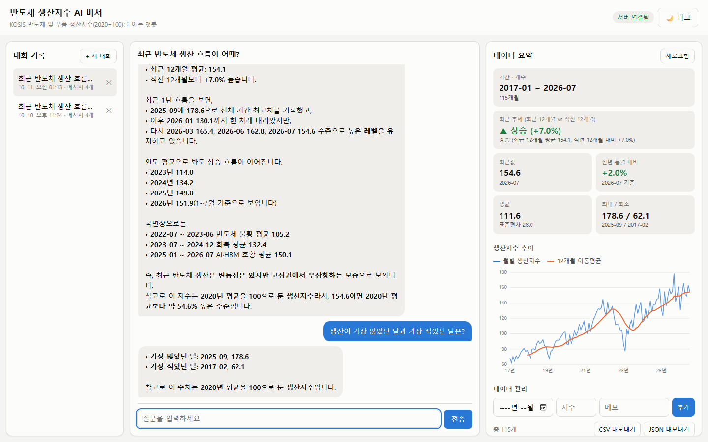
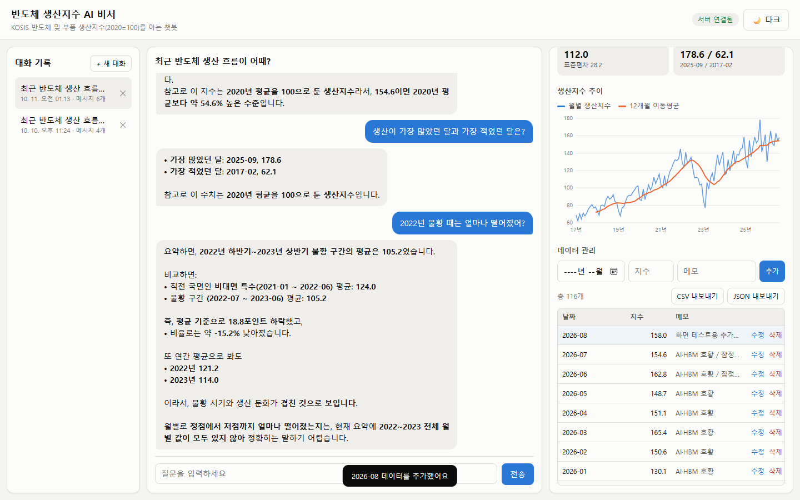
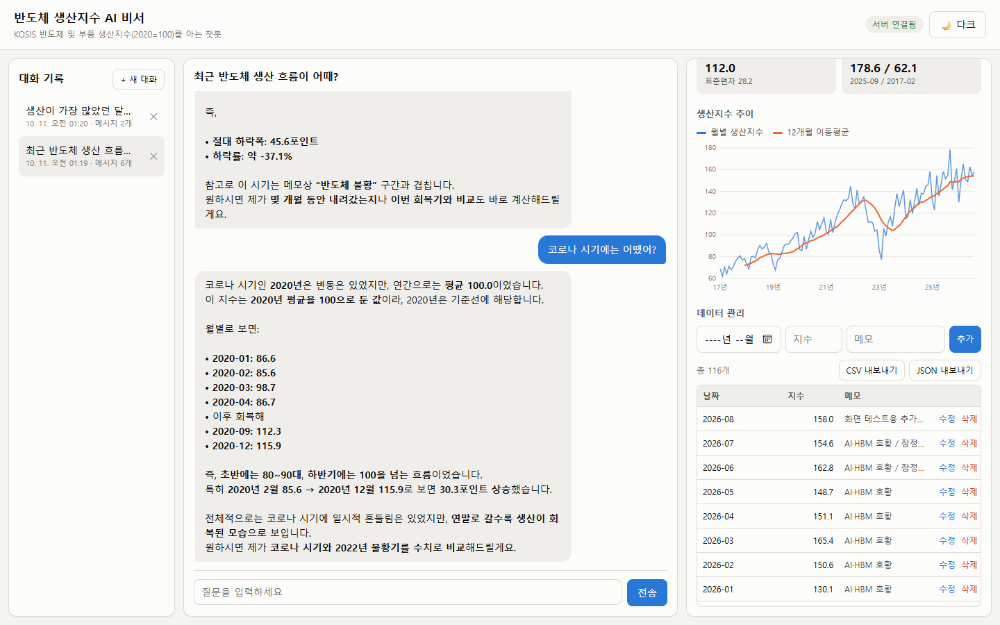
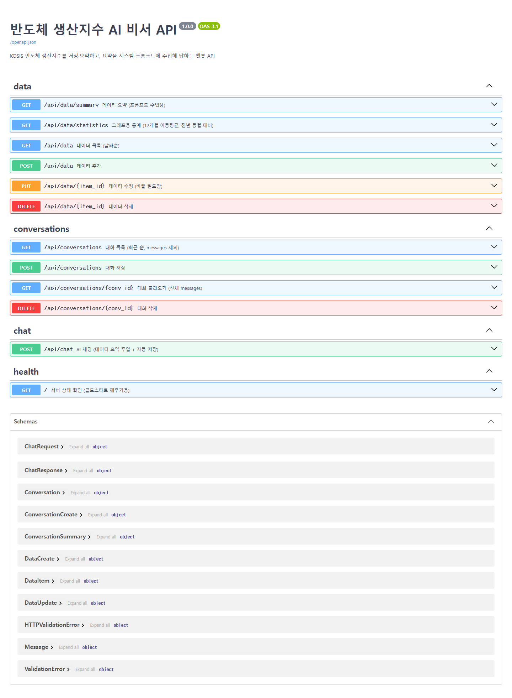

# 반도체 생산지수 AI 비서

일반 챗봇은 내 데이터를 모른다. "최근 반도체 생산 흐름이 어때?"라고 물으면 일반론만 돌아온다.
이 서비스는 KOSIS 반도체 생산지수 115개월치를 Firestore에 저장하고, 그 요약을 GPT의 시스템 프롬프트에 넣어서 **내 데이터를 근거로 숫자와 날짜를 들어 답하는 AI 비서**를 만든다.

## 배포 주소

| 구분 | 주소 |
|---|---|
| 프론트엔드 (Vercel) | https://ai-data-chatbot-frontend.vercel.app |
| 백엔드 API (Render) | https://ai-data-chatbot-rgp0.onrender.com |
| Swagger UI | https://ai-data-chatbot-rgp0.onrender.com/docs |

> 백엔드는 Render 무료 티어라서 15분 동안 요청이 없으면 잠든다. 첫 접속은 서버가 깨어나는 데 최대 1분 정도 걸리며, 화면 상단에 "서버를 깨우는 중" 안내와 진행 상태가 표시된다.

## 주요 기능

1. 데이터 기반 AI 채팅
   질문을 보내면 서버가 데이터 요약을 만들어 시스템 프롬프트에 넣고 GPT를 호출한다. 답변이 오는 동안 로딩 표시가 나오고, 대화는 자동으로 저장된다.
2. 데이터 관리 (CRUD)
   (date, value, memo) 데이터를 화면에서 추가·수정·삭제한다. 바뀌면 목록, 요약, 그래프가 함께 갱신된다.
3. 대화 기록
   왼쪽 목록에서 이전 대화를 눌러 다시 불러오고, 이어서 질문하거나 삭제할 수 있다.
4. 데이터 요약 표시
   기간, 개수, 최근 추세, 최근값, 전년 동월 대비, 평균, 표준편차, 최대·최소를 카드로 보여 준다.
5. 보너스
   생산지수와 12개월 이동평균 그래프(마우스를 올리면 값 표시), CSV·JSON 내보내기, 다크 모드 토글, 추가 지표(전년 동월 대비 증감률, 12개월 이동평균, 표준편차, 연도별·국면별 평균).

## 데이터

| 항목 | 내용 |
|---|---|
| 출처 | KOSIS 광업제조업동향조사, 반도체 및 부품(C26A) 생산지수 (2020=100) |
| 기간 | 2017-01 ~ 2026-07 (월별 115개, 결측 0) |
| 형태 | `date`(YYYY-MM), `value`(지수), `memo`(국면 이름, 이상치·잠정치 표시) |

이전 미션([semiconductor-kshape-analysis](https://github.com/041211lhs/semiconductor-kshape-analysis))에서 정리한 데이터를 재사용했다. memo에는 그 분석에서 나눈 7개 국면(메모리 슈퍼사이클, 다운사이클, 코로나, 비대면 특수, 반도체 불황, 회복, AI·HBM 호황)을 적었다.

## 기술 스택

| 영역 | 사용 기술 |
|---|---|
| 백엔드 | Python 3.13, FastAPI, Pydantic, Uvicorn |
| DB | Firebase Firestore (firebase-admin) |
| AI | OpenAI 호환 API (openai SDK, 코디세이 제공 엔드포인트, gpt-5.4) |
| 프론트엔드 | HTML, CSS, JavaScript (프레임워크 없음), 그래프는 SVG 직접 그리기 |
| 배포 | Render (백엔드), Vercel (프론트엔드) |

## 동작 흐름 (컨텍스트 주입)

```
사용자 질문
  → POST /api/chat
      1. Firestore data 컬렉션 전체 조회
      2. 요약 계산 (GET /api/data/summary 와 같은 함수)
      3. 요약과 전체 월별 값(약 1천 토큰)을 시스템 프롬프트의 [사용자 데이터 요약] 자리에 삽입
      4. 시스템 프롬프트 + 이전 대화(최근 10개) + 질문으로 GPT 호출
      5. 질문과 답변을 conversations 컬렉션에 자동 저장
  ← { conversation_id, reply }
```

GPT는 학습 데이터에 이 사용자의 데이터가 없다. 그래서 매 요청마다 요약을 시스템 프롬프트에 넣어 "지금 이 데이터"를 알려 준다. 이것이 컨텍스트 주입이다. 데이터를 추가·수정하면 다음 질문부터 바로 반영된다.

시스템 프롬프트 형식은 아래와 같다.

```
당신은 반도체 생산 데이터 분석 비서입니다.

[사용자 데이터 요약]
- 데이터 기간: {period}
- 총 레코드: {count}개
- 주요 지표: {metrics}
- 최근 트렌드: {trend}
- 연도별 평균 / 메모(국면)별 구간 평균 / 최근 12개월 값 / 전체 월별 값

[답변 규칙] 숫자와 날짜를 근거로, 없는 값은 지어내지 말 것, 원인은 단정하지 말 것
```

## API

| 메서드 | 경로 | 설명 |
|---|---|---|
| GET | `/` | 서버 상태 확인 (콜드스타트 깨우기용) |
| POST | `/api/data` | 데이터 추가 (같은 날짜가 있으면 409) |
| GET | `/api/data` | 데이터 목록 (날짜순) |
| PUT | `/api/data/{id}` | 데이터 수정 (바꿀 필드만 보냄) |
| DELETE | `/api/data/{id}` | 데이터 삭제 |
| GET | `/api/data/summary` | 데이터 요약 (프롬프트 주입용) |
| GET | `/api/data/statistics` | 그래프용 통계 (12개월 이동평균, 전년 동월 대비) |
| POST | `/api/conversations` | 대화 저장 |
| GET | `/api/conversations` | 대화 목록 (최근 순, **messages 미포함**) |
| GET | `/api/conversations/{id}` | 대화 불러오기 (**전체 messages 포함**) |
| DELETE | `/api/conversations/{id}` | 대화 삭제 |
| POST | `/api/chat` | AI 채팅 (`conversation_id`를 보내면 이어서 대화) |

대화 불러오기는 과제의 (A) 방식이다. 목록은 가볍게 제목·메시지 수·수정 시각만 주고, 특정 대화의 메시지 전체는 `GET /api/conversations/{id}`로 받는다.

요약 응답 예시 (`GET /api/data/summary`, 일부)

```json
{
  "period": "2017-01 ~ 2026-07",
  "count": 115,
  "metrics": {
    "average": 111.6,
    "max": { "value": 178.6, "date": "2025-09" },
    "min": { "value": 62.1, "date": "2017-02" },
    "latest": { "value": 154.6, "date": "2026-07" },
    "std": 28.0,
    "latest_yoy_pct": 2.0
  },
  "trend": "상승 (최근 12개월 평균 154.1, 직전 12개월 대비 +7.0%)"
}
```

추세는 최근 12개월 평균을 직전 12개월 평균과 비교해서 정한다. +3% 이상이면 상승, -3% 이하면 하락, 그 사이면 유지다. 월별 값은 출렁임이 커서 한 달끼리 비교하면 추세가 자주 뒤집히기 때문에 12개월 평균끼리 비교했다.

## 프로젝트 구조

```
ai-data-chatbot/
├─ backend/
│  ├─ main.py               앱 생성, CORS, 라우터 연결, 공통 예외 처리
│  ├─ core/config.py        환경 변수 읽기
│  ├─ schemas.py            Pydantic 요청·응답 모델 (입력 검증)
│  ├─ routers/              주소와 입출력만 담당 (data, conversations, chat)
│  ├─ services/             실제 처리 (firestore 연결, 데이터 CRUD, 요약 계산, 대화, GPT 호출)
│  ├─ seed.py               CSV를 Firestore에 올리는 스크립트
│  ├─ data/semiconductor_production.csv
│  └─ requirements.txt
├─ frontend/
│  ├─ index.html, style.css, app.js
│  ├─ build.js              Vercel 빌드 시 API_BASE_URL로 config.js 생성
│  └─ vercel.json
└─ docs/screenshots/
```

**라우터와 서비스를 나눈 기준**
라우터는 "어떤 주소로 무엇을 받아 무엇을 돌려주는가"만 정한다. 서비스는 "실제로 무슨 일을 하는가"를 맡는다. 예를 들어 `/api/chat` 라우터는 한 줄로 `chat_service.chat()`을 부를 뿐이다. 이렇게 나누면 요약 계산(`summary_service`)을 `/api/data/summary`와 `/api/chat`이 같은 함수로 함께 쓸 수 있다. 서비스는 HTTP를 모르고 `NotFoundError` 같은 자체 예외만 던진다. 이것을 404·409·502 같은 상태 코드로 바꾸는 일은 `main.py`가 한곳에서 맡는다.

**Pydantic 입력 검증**
요청 본문이 라우터 함수에 닿기 전에 형식을 자동으로 검사한다. 틀리면 FastAPI가 422 에러로 어느 필드가 왜 틀렸는지 알려 준다.
- `date`: `YYYY-MM` 형식만 허용 (예: `2026-13`은 거절)
- `value`: 0 ~ 1000 사이 숫자
- `memo`: 200자 이하
- 채팅 `message`: 1 ~ 1000자, 공백만 있으면 거절
- 대화 메시지 `role`: `user` 또는 `assistant`만 허용

## Firestore 컬렉션 구조

```
data/{자동ID}
  date: "2026-07"        value: 154.6        memo: "AI·HBM 호황 / 잠정치"
  created_at, updated_at

conversations/{자동ID}
  title: "최근 반도체 생산 흐름이 어때?"
  messages: [ { role: "user", content: "..." }, { role: "assistant", content: "..." } ]
  message_count: 2
  created_at, updated_at
```

## 로컬 실행 방법

준비물은 Python 3.10 이상, Firebase 서비스 계정 키(JSON), OpenAI API 키다.

```bash
# 1) 백엔드
cd backend
python -m venv .venv
.venv\Scripts\activate            # macOS/Linux: source .venv/bin/activate
pip install -r requirements.txt
copy .env.example .env            # macOS/Linux: cp .env.example .env
# .env에 키를 채우고, 서비스 계정 키 파일을 backend/firebase-key.json으로 둔다
python seed.py                    # 데이터 115개 업로드 (처음 한 번)
uvicorn main:app --reload         # http://127.0.0.1:8000/docs

# 2) 프론트엔드 (새 터미널)
cd frontend
echo window.API_BASE_URL = "http://127.0.0.1:8000"; > config.js
python -m http.server 5500        # http://localhost:5500
```

## 환경 변수

**백엔드 (Render)**

| 이름 | 설명 | 예시 |
|---|---|---|
| `OPENAI_API_KEY` | OpenAI API 키 | `sk-...` |
| `OPENAI_BASE_URL` | OpenAI 호환 엔드포인트 (비우면 OpenAI 기본) | `https://copa.codyssey.kr/v1` |
| `OPENAI_MODEL` | 사용할 모델 | `gpt-5.4` |
| `OPENAI_MAX_TOKENS` | 답변 최대 토큰 (비용 상한) | `1000` |
| `FIREBASE_SERVICE_ACCOUNT_JSON` | 서비스 계정 키. 로컬은 파일 경로, Render는 JSON 내용 전체 | `firebase-key.json` 또는 `{"type":"service_account",...}` |
| `ALLOWED_ORIGINS` | CORS 허용 도메인 (쉼표 구분) | `https://xxx.vercel.app,http://localhost:5500` |

**프론트엔드 (Vercel)**

| 이름 | 설명 |
|---|---|
| `API_BASE_URL` | 백엔드 주소. 빌드할 때 `config.js`로 만들어진다 |

## 보안과 운영에서 신경 쓴 점

- **키 관리**: API 키와 서비스 계정 키는 코드에 쓰지 않는다. 로컬은 `.env`와 키 파일, 배포는 Render 환경 변수로만 넣는다. `.env`, `firebase-key.json`, `config.js`는 `.gitignore`로 GitHub에 올라가지 않는다. 키가 저장소에 한 번이라도 올라가면 기록에 남아 누구나 내 DB를 지우거나 내 돈으로 GPT를 쓸 수 있기 때문이다.
- **CORS**: 브라우저는 다른 도메인(Vercel)에서 API(Render)를 부를 때 서버가 허용한 도메인인지 확인한다. `ALLOWED_ORIGINS`에 적힌 도메인만 허용하고, 그 밖의 도메인에서 온 요청은 브라우저가 막는다.
- **환경 변수로 주소 분리**: 프론트는 서버 주소를 코드에 박지 않고 Vercel 환경 변수 `API_BASE_URL`로 받는다. 서버 주소가 바뀌어도 코드는 그대로 두고 설정만 바꾸면 된다.
- **비용 제한**: `max_completion_tokens`로 답변 길이를 제한하고, 이전 대화는 최근 10개 메시지만 함께 보낸다.
- **예외 처리**: 없는 id는 404, 날짜 중복은 409, 형식 오류는 422, DB 설정 누락은 503, AI 호출 실패는 502로 응답한다. 화면에는 사람이 읽을 수 있는 메시지로 보여 준다.
- **Firestore 보안 규칙**: 잠금(프로덕션) 모드로 만들었다. 브라우저가 DB에 직접 접근하지 못하고 서버(Admin SDK)만 읽고 쓴다.

## 제출 스크린샷

**1. 데이터 요약이 보이는 채팅 화면 (질문 + 답변)**



**2. 데이터 관리 화면 (추가 동작)**



**3. 대화 기록 화면 (불러오기 동작)**



**4. Swagger UI**


